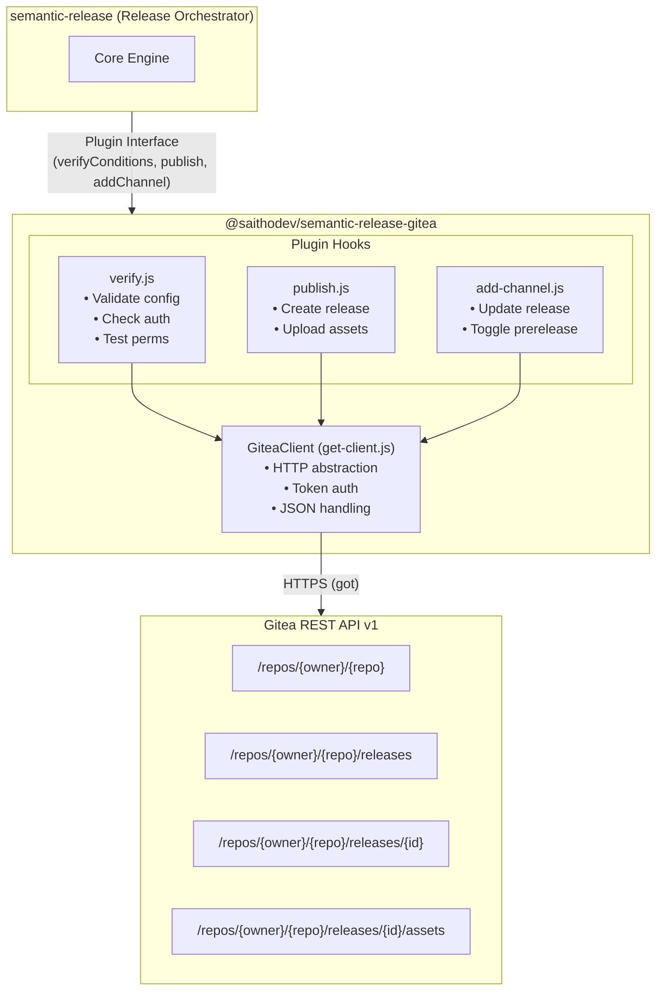
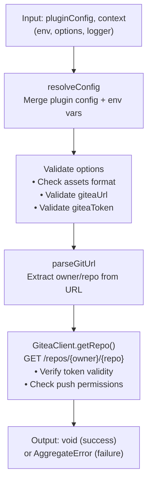
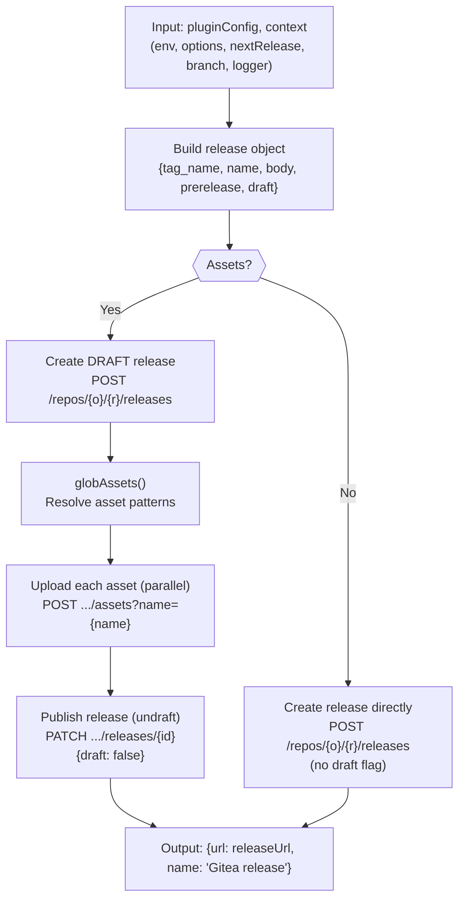

# Architecture Documentation

## Project: @saithodev/semantic-release-gitea

**Generated:** 2025-12-02
**Version:** 2.1.0
**Type:** semantic-release Plugin (Library)

---

## Executive Summary

`@saithodev/semantic-release-gitea` is a semantic-release plugin that enables automated release publishing to Gitea instances. It implements the standard semantic-release plugin interface with three lifecycle hooks: `verifyConditions`, `publish`, and `addChannel`.

The library follows a modular architecture with clear separation of concerns, using a dedicated HTTP client class for Gitea API interactions and comprehensive error handling with user-friendly messages.

---

## Architecture Overview

### Architecture Pattern

**Plugin Architecture** with **Modular Design**

This library implements the semantic-release plugin contract, acting as an adapter between semantic-release's release lifecycle and the Gitea REST API.



---

## Component Architecture

### Core Modules

| Module | Responsibility | Dependencies |
|--------|---------------|--------------|
| `index.js` | Entry point, exports plugin hooks | verify, publish, add-channel |
| `lib/verify.js` | Config validation, auth verification | resolve-config, get-client, get-error, parse-git-url |
| `lib/publish.js` | Release creation, asset upload | resolve-config, get-client, glob-assets, is-prerelease |
| `lib/add-channel.js` | Release prerelease flag updates | resolve-config, get-client, is-prerelease |

### Support Modules

| Module | Responsibility | Exports |
|--------|---------------|---------|
| `lib/get-client.js` | HTTP client factory | `GiteaClient` instance |
| `lib/resolve-config.js` | Config/env merging | Config object |
| `lib/parse-git-url.js` | Git URL parsing | `{owner, repo}` |
| `lib/glob-assets.js` | Asset glob resolution | Array of file paths |
| `lib/is-prerelease.js` | Prerelease detection | Boolean |
| `lib/get-error.js` | Error factory | `SemanticReleaseError` |
| `lib/definitions/errors.js` | Error messages | Error definitions |
| `lib/definitions/constants.js` | Constants | `RELEASE_NAME` |

---

## Data Flow

### verifyConditions Flow



### publish Flow



---

## Technology Stack

| Category | Technology | Version | Purpose |
|----------|------------|---------|---------|
| Runtime | Node.js | ^10, ^11, ^12, >=14 | JavaScript runtime |
| HTTP | got | ^10.0.1 | HTTP client |
| Utilities | lodash | ^4.17.21 | Object manipulation |
| File I/O | fs-extra | ^8.0.0 | File operations |
| Globbing | globby | ^10.0.0 | File pattern matching |
| Forms | form-data | ^3.0.0 | Multipart uploads |
| URLs | url-join | ^4.0.0 | URL construction |
| Errors | @semantic-release/error | ^2.2.0 | Structured errors |
| Errors | aggregate-error | ^3.0.0 | Error aggregation |
| Debug | debug | ^4.0.0 | Debug logging |

---

## API Design

### Plugin Interface (semantic-release contract)

```javascript
// index.js exports
module.exports = {
  verifyConditions,  // async (pluginConfig, context) => void
  publish,           // async (pluginConfig, context) => {url, name}
  addChannel         // async (pluginConfig, context) => {url, name}
};
```

### GiteaClient API

```javascript
class GiteaClient {
  constructor(giteaToken, giteaUrl, giteaApiPathPrefix)

  // Repository
  getRepo(repo, owner)                    // GET /repos/{owner}/{repo}

  // Releases
  createRelease(owner, repo, release)     // POST /repos/{owner}/{repo}/releases
  updateRelease(owner, repo, id, data)    // PATCH /repos/{owner}/{repo}/releases/{id}
  getReleaseByTag(owner, repo, gitTag)    // GET /repos/{owner}/{repo}/releases (paginated search)

  // Assets
  createReleaseAsset(owner, repo, releaseId, assetName, filePath)
                                          // POST /repos/{owner}/{repo}/releases/{id}/assets
}
```

### Configuration Schema

```javascript
// Plugin configuration options
{
  giteaUrl: String,           // Gitea instance URL (or GITEA_URL env)
  giteaApiPathPrefix: String, // API prefix (default: /api/v1, or GITEA_PREFIX env)
  assets: Array<String|Object> // Files to upload
}

// Asset object format
{
  path: String|Array<String>, // Glob pattern(s)
  name: String,               // Download filename (supports templates)
  label: String               // Display label (supports templates)
}
```

---

## Error Handling

### Error Types

| Code | Scenario | User Action |
|------|----------|-------------|
| `EINVALIDASSETS` | Invalid assets config | Fix assets array format |
| `ENOGITEAURL` | Missing Gitea URL | Set `GITEA_URL` env var |
| `ENOGITEATOKEN` | Missing auth token | Set `GITEA_TOKEN` env var |
| `EINVALIDGITEAURL` | Bad repository URL | Fix `repositoryUrl` option |
| `EINVALIDGITEATOKEN` | Invalid/expired token | Generate new Gitea token |
| `EMISSINGREPO` | Repository not found | Check repo exists and URL |
| `EGITEANOPERMISSION` | No push permission | Grant token push access |
| `EGITEAAPIERROR` | API error response | Check Gitea logs |

### Error Structure

All errors are `SemanticReleaseError` instances with:
- `message`: Short description
- `code`: Error code (for programmatic handling)
- `details`: Markdown with documentation links and guidance

---

## Security Considerations

1. **Token Storage**: `GITEA_TOKEN` should be stored in CI secrets, never committed
2. **Permissions**: Token needs push permission to target repository
3. **HTTPS**: All API calls use HTTPS (got client)
4. **No Sensitive Logging**: Token is not logged (only used in headers)

---

## Extension Points

### Adding New Gitea API Methods

1. Add method to `GiteaClient` class in `lib/get-client.js`
2. Follow existing pattern: `_makeRequest(verb, apiPath, body)`

### Adding New Plugin Options

1. Add to `resolveConfig()` in `lib/resolve-config.js`
2. Add validation in `lib/verify.js` VALIDATORS object
3. Add error definition in `lib/definitions/errors.js`

### Adding New Lifecycle Hooks

1. Create new module in `lib/`
2. Export from `index.js`
3. Add tests in `test/`

---

## Testing Strategy

| Test Type | Framework | Coverage |
|-----------|-----------|----------|
| Unit | AVA | Individual modules |
| Integration | AVA + nock | End-to-end flows |
| HTTP Mocking | nock | Gitea API simulation |
| Spies/Stubs | sinon | Logger, callbacks |

Coverage target: All `lib/` files + `index.js`

---

## Deployment

This is an npm package deployed via semantic-release:

1. Push to `master` triggers test workflow
2. On success, release workflow runs
3. semantic-release analyzes commits
4. If releasable: version bump, changelog, npm publish, GitHub release
