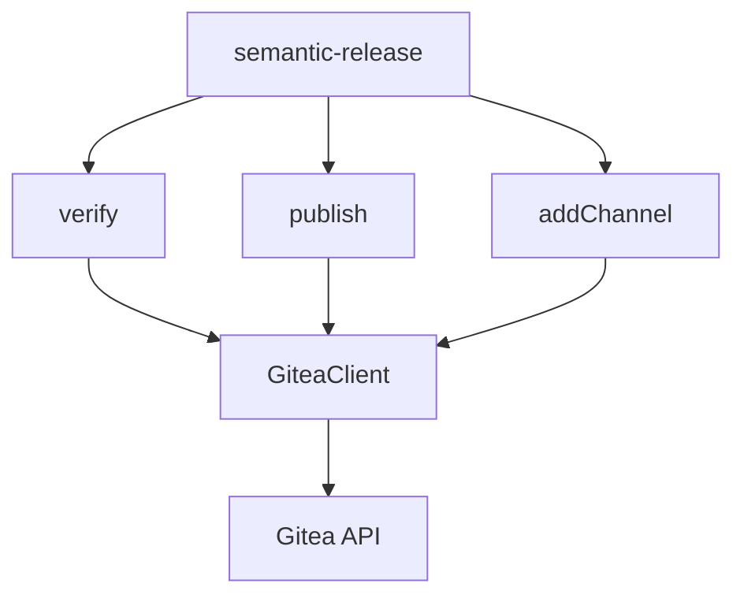

# Project Documentation Index

## @saithodev/semantic-release-gitea

**Generated:** 2025-12-02
**Scan Level:** Deep
**Mode:** Initial Scan

---

## Project Overview

- **Type:** Monolith (single cohesive codebase)
- **Project Category:** Library (npm package)
- **Primary Language:** JavaScript (Node.js)
- **Architecture:** Plugin Architecture (semantic-release plugin)

---

## Quick Reference

| Attribute | Value |
|-----------|-------|
| **Package** | `@saithodev/semantic-release-gitea` |
| **Version** | 2.1.0 |
| **Entry Point** | `index.js` |
| **Tech Stack** | Node.js, got, lodash, AVA |
| **Source Files** | ~490 LOC |
| **Test Files** | ~700 LOC |

---

## Generated Documentation

### Core Documents

| Document | Description |
|----------|-------------|
| [Project Overview](./project-overview.md) | Executive summary, features, quick start |
| [Architecture](./architecture.md) | System design, data flows, component architecture |
| [Source Tree Analysis](./source-tree-analysis.md) | Directory structure, module dependencies |
| [Development Guide](./development-guide.md) | Setup, testing, contributing, CI/CD |

### Technical Reference

| Document | Description |
|----------|-------------|
| [Architecture](./architecture.md#api-design) | Plugin API, GiteaClient API |
| [Architecture](./architecture.md#error-handling) | Error codes and handling |
| [Source Tree](./source-tree-analysis.md#module-dependency-flow) | Module dependency diagram |

---

## Existing Documentation

| Document | Location | Description |
|----------|----------|-------------|
| [README](../README.md) | Project root | Usage guide, configuration, examples |
| [CONTRIBUTING](../CONTRIBUTING.md) | Project root | Contribution guidelines |
| [CHANGELOG](../CHANGELOG.md) | Project root | Release history |

---

## Getting Started

### For Users

1. Install: `npm install @saithodev/semantic-release-gitea -D`
2. Configure in `.releaserc.json` or `package.json`
3. Set `GITEA_URL` and `GITEA_TOKEN` environment variables
4. See [README](../README.md) for full configuration options

### For Developers

1. Clone the repository
2. Run `nvm use` (if using nvm)
3. Run `npm install`
4. Run `npm test` to verify setup
5. See [Development Guide](./development-guide.md) for full details

---

## Architecture Summary

---

## Key Integration Points

| Integration | Type | Documentation |
|-------------|------|---------------|
| semantic-release | Plugin hooks | [Architecture](./architecture.md#plugin-interface-semantic-release-contract) |
| Gitea API v1 | REST API | [Architecture](./architecture.md#giteaclient-api) |
| GitHub Actions | CI/CD | [Development Guide](./development-guide.md#cicd-pipeline) |

---

## Scan Metadata

| Field | Value |
|-------|-------|
| **Workflow Version** | 1.2.0 |
| **Scan Started** | 2025-12-02T21:51:50Z |
| **Project Root** | `/home/joseybv/workspace/semantic-release-gitea` |
| **Files Analyzed** | 27 |
| **Total LOC** | ~1,490 |

---

## Next Steps

When planning new features for this project:

1. Reference [Architecture](./architecture.md) for system design
2. Follow patterns in [Source Tree Analysis](./source-tree-analysis.md)
3. Use [Development Guide](./development-guide.md) for setup/testing
4. Consult [README](../README.md) for user-facing documentation

---

*This documentation was generated by the BMAD Document Project workflow.*
