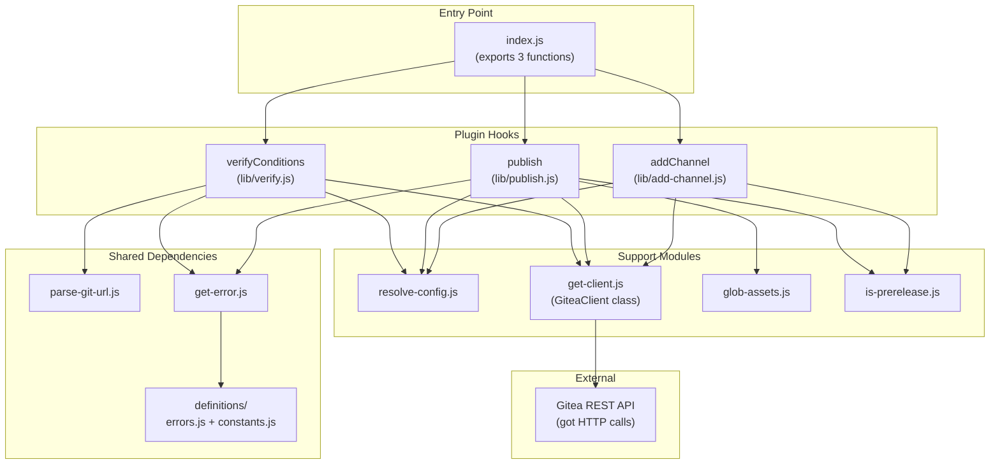

# Source Tree Analysis

## Project: @saithodev/semantic-release-gitea

**Generated:** 2025-12-02
**Scan Level:** Deep
**Project Type:** Library (npm package)

---

## Directory Structure

```
semantic-release-gitea/
│
├── index.js                    # [ENTRY POINT] Main module exports
│                               # Exports: verifyConditions, publish, addChannel
│
├── lib/                        # [CORE] Library source code
│   ├── add-channel.js          # Updates release prerelease status
│   ├── get-client.js           # GiteaClient class - HTTP API wrapper
│   ├── get-error.js            # Error factory using definitions
│   ├── glob-assets.js          # Asset glob pattern resolution
│   ├── is-prerelease.js        # Prerelease detection logic
│   ├── parse-git-url.js        # Git URL → owner/repo parser
│   ├── publish.js              # Release creation & asset upload
│   ├── resolve-config.js       # Config & env variable merging
│   ├── verify.js               # Auth & configuration validation
│   │
│   └── definitions/            # [DEFINITIONS] Constants & error messages
│       ├── constants.js        # RELEASE_NAME constant
│       └── errors.js           # Error message definitions with docs links
│
├── test/                       # [TESTS] AVA test suite
│   ├── add-channel.test.js     # Tests for addChannel function
│   ├── glob-assets.test.js     # Tests for glob pattern handling
│   ├── integration.test.js     # End-to-end workflow tests
│   ├── publish.test.js         # Tests for publish function
│   ├── verify.test.js          # Tests for verifyConditions
│   │
│   ├── helpers/                # [TEST HELPERS]
│   │   └── _mock-gitea.js      # Nock-based Gitea API mocking
│   │
│   └── fixtures/               # [TEST DATA]
│       └── files/              # Sample files for upload tests
│           ├── .dotfile
│           ├── upload.txt
│           ├── upload_other.txt
│           └── my-software-v1.0.0.tar.gz
│
├── .github/                    # [CI/CD] GitHub Actions
│   └── workflows/
│       ├── test.yml            # Test matrix (Node 10, 11, 12, 14, 15)
│       └── release.yml         # Automated release on test success
│
├── docs/                       # [DOCUMENTATION] Generated docs (this folder)
│   └── ...
│
├── package.json                # [CONFIG] npm package manifest
├── package-lock.json           # [CONFIG] Dependency lock file
├── .releaserc.json             # [CONFIG] semantic-release configuration
├── .nvmrc                      # [CONFIG] Node version specification (12.13.1)
├── .gitignore                  # [CONFIG] Git ignore patterns
├── .npmignore                  # [CONFIG] npm publish ignore patterns
├── sonar-project.properties    # [CONFIG] SonarCloud configuration
│
├── README.md                   # [DOCS] Primary documentation
├── CONTRIBUTING.md             # [DOCS] Contribution guidelines
└── CHANGELOG.md                # [DOCS] Release history
```

---

## Critical Folders Explained

### `/lib` - Core Library

The heart of the plugin. All production code lives here. The modules follow a clean single-responsibility pattern:

| Module | Responsibility |
|--------|---------------|
| `verify.js` | Validates config, checks Gitea auth, verifies repo permissions |
| `publish.js` | Creates releases, handles draft → publish workflow for assets |
| `add-channel.js` | Updates existing releases for channel management |
| `get-client.js` | Encapsulates all Gitea API HTTP calls |
| `glob-assets.js` | Resolves asset glob patterns to file lists |
| `resolve-config.js` | Merges plugin config with environment variables |

### `/lib/definitions` - Error & Constant Definitions

Contains structured error messages with documentation links and the RELEASE_NAME constant. Error messages are designed to be user-friendly with actionable guidance.

### `/test` - Test Suite

Comprehensive test coverage using AVA framework with:
- **Unit tests** for individual modules
- **Integration tests** for end-to-end flows
- **HTTP mocking** via nock for Gitea API simulation

### `/.github/workflows` - CI/CD

- **test.yml**: Runs tests across Node.js matrix on push/PR
- **release.yml**: Triggers semantic-release after successful tests on master

---

## Module Dependency Flow



---

## File Statistics

| Category | Files | Lines (approx) |
|----------|-------|----------------|
| Source (`lib/`) | 11 | ~490 |
| Tests (`test/`) | 6 | ~700 |
| Config files | 7 | ~150 |
| Documentation | 3 | ~150 |
| **Total** | **27** | **~1,490** |

---

## Key Integration Points

1. **semantic-release Plugin Interface**
   - Implements standard lifecycle hooks: `verifyConditions`, `publish`, `addChannel`
   - Receives `context` object with env, options, nextRelease, logger

2. **Gitea API v1**
   - Base path: `{GITEA_URL}/api/v1` (configurable via `GITEA_PREFIX`)
   - Auth: Token-based (`Authorization: token {GITEA_TOKEN}`)

3. **External Dependencies**
   - `got` for HTTP requests
   - `globby` + `dir-glob` for asset pattern matching
   - `form-data` for multipart uploads
